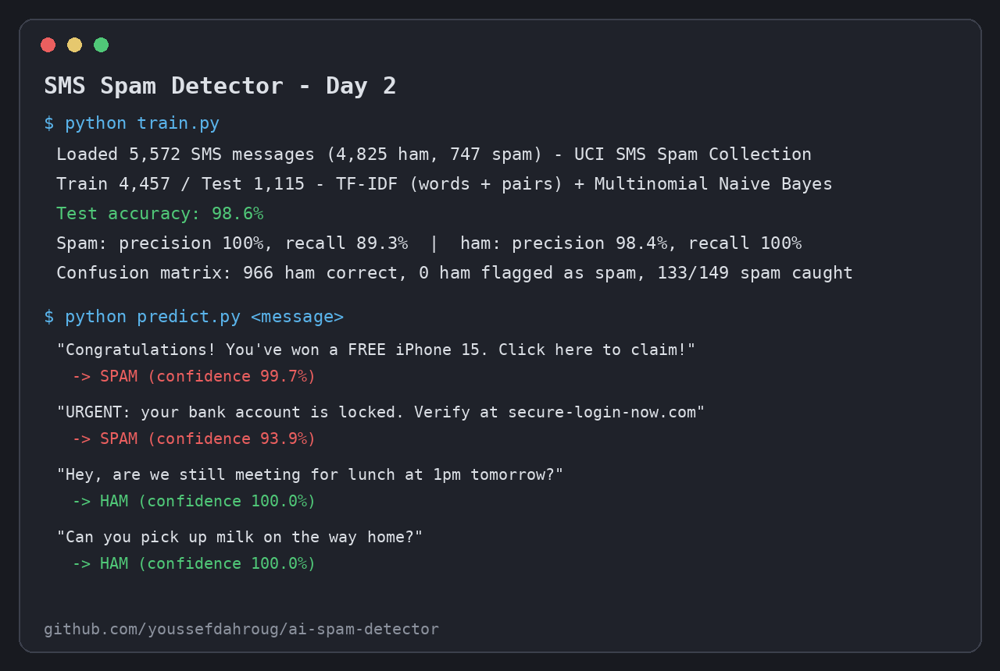

# AI Spam Detector

Day 2 of my daily AI project challenge.

A small Python tool that reads an SMS-style message and says if it is spam or ham (legitimate), with a confidence score. It uses TF-IDF features (single words and word pairs) with a Multinomial Naive Bayes classifier from scikit-learn.



## Results

Trained on 5,572 labelled SMS messages (80% train, 20% test, seed 42, stratified).

- Test accuracy: **0.986** on 1,115 unseen messages
- Spam: precision **1.000**, recall **0.893**
- Ham: precision **0.984**, recall **1.000** (zero legitimate messages flagged as spam)

## How it works

- Data: SMS Spam Collection from the UCI Machine Learning Repository (5,572 messages: 4,825 ham, 747 spam).
- Features: TF-IDF over single words and word pairs (ngram_range=(1,2), min_df=2, sublinear tf), so phrases like "click here" and "free entry" carry weight.
- Model: Multinomial Naive Bayes (alpha=0.1), a classic baseline for text classification.
- The trained pipeline (vectorizer + model) is saved with joblib, so `predict.py` loads it and scores any new message.

## Dataset

Download the SMS Spam Collection from UCI:
https://archive.ics.uci.edu/dataset/228/sms+spam+collection

Extract it and place the `SMSSpamCollection` file next to `train.py`.

## How to run

```bash
pip install -r requirements.txt
python train.py
python predict.py "Congratulations! You won a free iPhone, click here"
```

## Files

- `train.py` - loads the data, trains the model, prints metrics, saves `model.joblib`
- `predict.py` - classifies a message from the command line with a confidence score
- `make_demo.py` - renders `demo.png` from the real run output
- `demo.png` - terminal-style card of the actual results

## License

MIT
